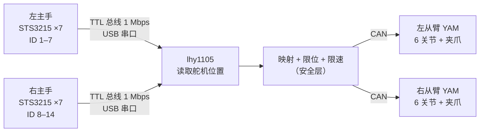
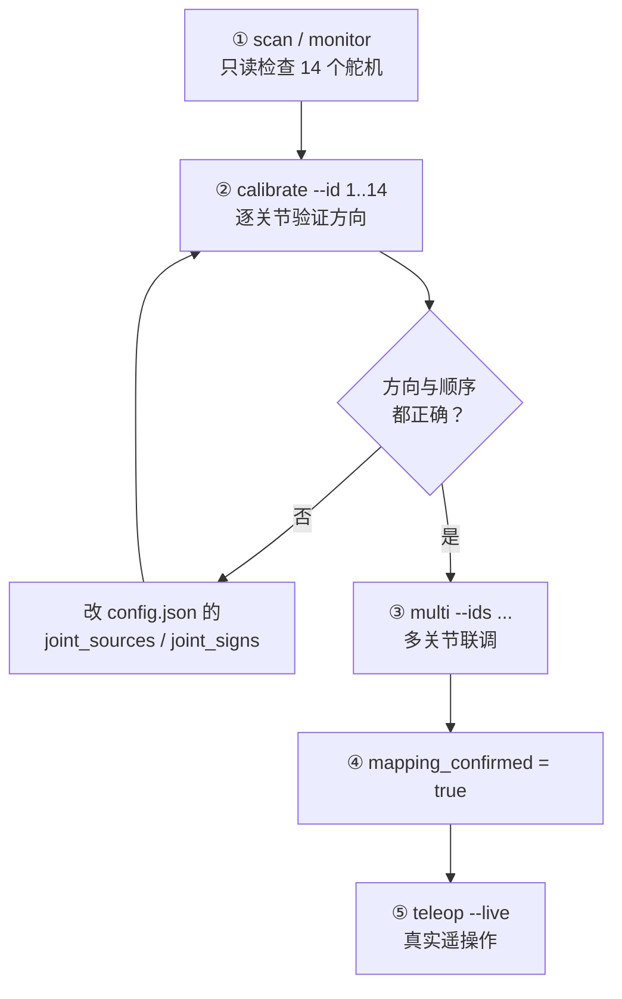
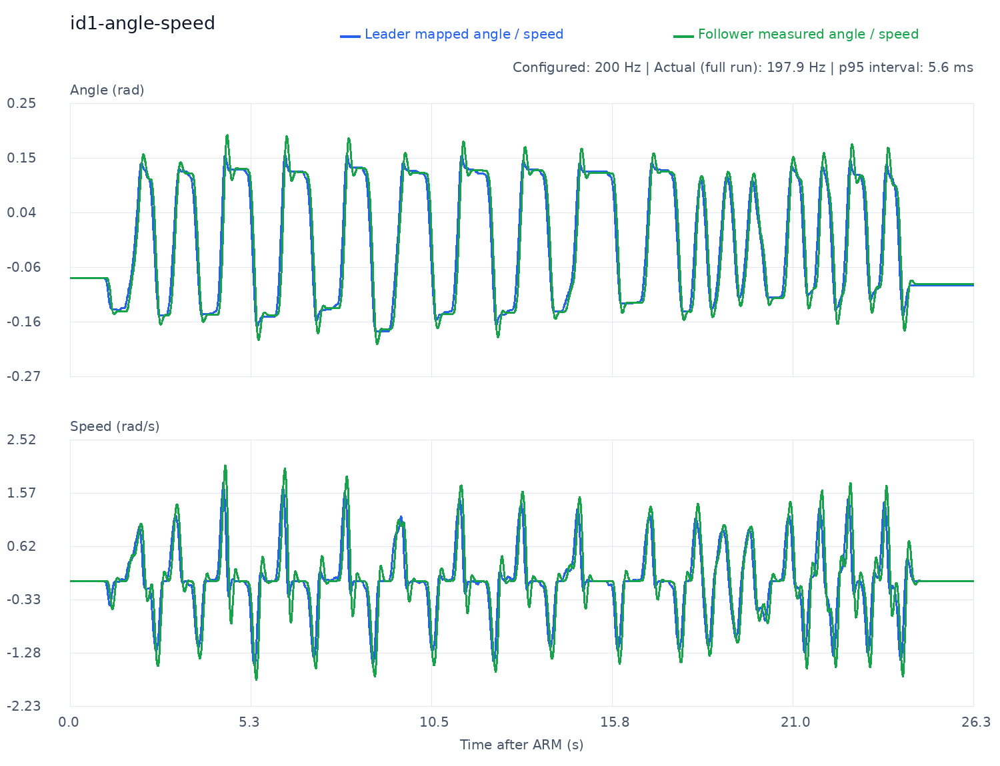
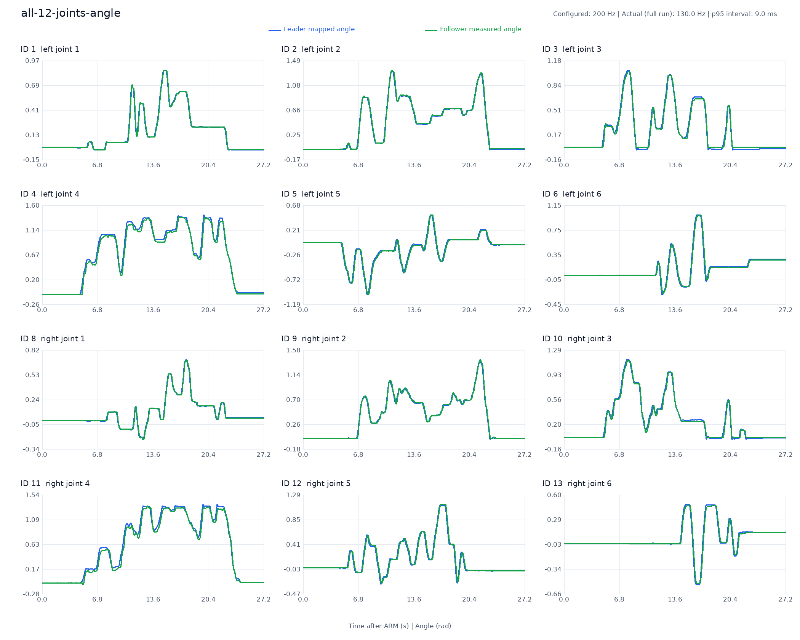

# lhy1105 · 双臂遥操作（STS3215 主手 → YAM 从臂）


**lhy1105** 是一套带安全保护的**双臂遥操作**程序：读取主手（FE-URT-2）上 14 个飞特
**STS3215** 舵机的位置，实时映射并驱动两条 **YAM** 从臂的 6 个关节（+ 可选夹爪）。

> ⚠️ 这是控制**真实机械臂**的软件，涉及安全风险。运行前请务必先读文末的
> [安全须知](#安全须知)。

---

## 1. 系统是怎么工作的



| 环节 | 说明 |
|------|------|
| **主手（Leader）** | FE-URT-2，通过 USB 串口连接；14 个 STS3215 舵机走 TTL 总线（1 Mbps）。ID 1–7 是左主手、8–14 是右主手，每组最后一个 ID 是夹爪。 |
| **lhy1105** | 读取主手位置 → 计算相对增量 → 做方向/顺序映射 → 限位 + 限速 → 下发从臂目标。 |
| **从臂（Follower）** | 两条 YAM 臂，各 7 个自由度（6 关节 + 1 夹爪），通过 CAN 控制。 |

> 注：URT-2 虽曾被称作“CAN 接口”，实际在本机呈现为 USB 串口；**从臂**才使用 CAN。

## 2. 硬件与 ID 映射

| 主手 ID | 所在手臂 | 对应从臂关节 | 说明 |
|:-------:|:--------:|:------------:|------|
| 1–6     | 左       | 关节 1–6     | 关节电机 |
| 7       | 左       | 左夹爪       | 夹爪 |
| 8–13    | 右       | 关节 1–6     | 关节电机 |
| 14      | 右       | 右夹爪       | 夹爪 |

两套配置：

| 配置文件 | 用途 | 从臂接口 | 夹爪 |
|----------|------|----------|------|
| `config.json` | 默认（14 个 ID） | `can_follower_l/r` | 有（`linear_4310`） |
| `config_can_leader.json` | 无电动夹爪的替代配置（12 个关节 ID） | `can_leader_l/r` | 无 |

## 3. 运行模式一览

| 命令 | 作用 | 会控制从臂吗 |
|------|------|:-----------:|
| `python -m lhy1105 scan` | 只读检查 14 个舵机 ID 与型号 | ❌ |
| `python -m lhy1105 monitor` | 只读实时打印位置 | ❌ |
| `python -m lhy1105 teleop` | 只读演练，打印目标偏移 | ❌ |
| `python -m lhy1105 teleop --live` | **真实遥操作** | ✅ |
| `python -m lhy1105 calibrate --id N` | 逐关节验证主从对应与方向 | ✅（单关节） |
| `python -m lhy1105 multi --ids ...` | 多关节联调 / 记录 | ✅ |
| `python scripts/plot_*.py` | 实时绘图 + 保存 CSV/PNG | ✅ |

## 4. 环境准备

在机器人（Linux）上运行。依赖：

- Python ≥ 3.10
- `numpy`、`pyserial`（见 `pyproject.toml`）
- `i2rt`（从臂驱动，**本仓库外的包**，需通过 `PYTHONPATH` 指向其目录）
- 绘图可选依赖 `Pillow`：`pip install -e ".[plot]"`

```bash
# 安装本包（可选，装完后可直接用 lhy1105 命令）
pip install -e .

# 或直接用模块方式运行
python -m lhy1105 scan
```

`i2rt` 不在本仓库内，运行前需保证能 import，例如：

```bash
export PYTHONPATH=/path/to/i2rt:$PYTHONPATH
```

串口设备路径与波特率在 `config.json` 的 `serial_port` / `baudrate` 中配置。

## 5. 快速开始

### ① 只读检查（安全起步）

```bash
python -m lhy1105 scan       # 检查 14 个舵机 ID 与型号（应为 777 = STS3215）
python -m lhy1105 monitor    # 实时打印位置（只读）
```

### ② 逐关节标定（确认方向与顺序）

```bash
python -m lhy1105 calibrate --id 1   # 检查左从臂关节 1，逐个换成 2..14
```

启动后按提示输入 `CONNECT`、`ARM`，再移动**选中的主臂关节**，从臂对应关节跟随。
用 `--sign -1` / `--sign 1` 可临时反转方向。

### ③ 多关节联调

```bash
python -m lhy1105 multi --ids 1 2 3                     # 单侧多关节
python -m lhy1105 multi --ids 1 2 8 9 --reverse 2       # 左右一起，临时反转 ID 2
python -m lhy1105 multi --ids 1 2 8 9 --lock-others     # 未选关节锁死在 ARM 位置
```

### ④ 真实遥操作

确认所有方向/顺序后，把 `config.json` 里 `mapping_confirmed` 改为 `true`，然后：

```bash
python -m lhy1105 teleop --live
```

## 6. 标定工作流（推荐顺序）



## 7. 可视化结果

实时绘图脚本会生成 CSV 和 PNG（保存在 `1120/idN/` 与 `1120/all/` 目录）。

### 单关节（角度 + 速度）

```bash
python scripts/plot_single_joint.py --id 2
```

上方面板：主臂映射后的目标角度（蓝）与从臂实际反馈角度（绿）；
下方面板：两者的速度曲线（rad/s）。



### 12 关节全景

```bash
python scripts/plot_all_joints.py
```

左右从臂各 6 个关节同时显示的 12 格实时图（蓝 = 主臂目标，绿 = 从臂反馈）。



## 8. 目录结构

```text
lhy1105/
├── lhy1105/                 # 主包
│   ├── cli.py               # 命令行入口（scan/monitor/teleop/calibrate/multi）
│   ├── config.py            # 配置加载与校验
│   ├── feetech.py           # 飞特 STS3215 总线读写
│   ├── mapping.py           # 映射、限位、限速
│   ├── calibration.py       # 单关节标定
│   └── multi_calibration.py # 多关节联调
├── scripts/                 # 实时绘图脚本
│   ├── plot_single_joint.py
│   └── plot_all_joints.py
├── tests/                   # 测试
├── docs/images/             # README 用图
├── config.json              # 主配置（14 ID，带夹爪）
├── config_can_leader.json   # 替代配置（12 关节，无夹爪）
├── pyproject.toml
└── README.md
```

## 9. 安全须知

- **软件控制不能替代硬件急停。** 运行前确保机械臂周围空旷、始终支撑双臂、急停可用。
- 确认 Dream station 或其它程序没有同时连接这两条 CAN。
- 实时控制前会检查全部 14 个 ID 和型号；任何读取超时、校验失败或舵机报错都会立即停止。
- 从臂目标始终饱和在 YAM 模型标称关节范围内；命令按 `max_velocity` 逐关节限速平滑。
- 正常退出时缓慢回到 rest（六个关节零位，夹爪 0.99），检查反馈到位后再释放力矩；
  **通讯或反馈故障时不会盲目回 rest，而是直接停机并报告错误**，请保持支撑。
- 主手可移动到从臂范围以外，但从臂不会越过其模型范围。
- 本程序不修改舵机 ID、零点、工作模式或电机超时设置。

## 10. 参考

- 关节增量映射与 follower API 参考本机 `~/uarm/i2rt/scripts/uarm2i2rt_right_follower.py`
- [LeRobot-Anything-U-Arm](https://github.com/MINT-SJTU/LeRobot-Anything-U-Arm) 的主从臂读取与夹爪控制思路
- 飞特 URT-2 读取使用 [FT-SCS 协议](https://ftservo.github.io/ftservo-wiki/reference/protocol/ft-scs/) 的 PING / READ 指令
